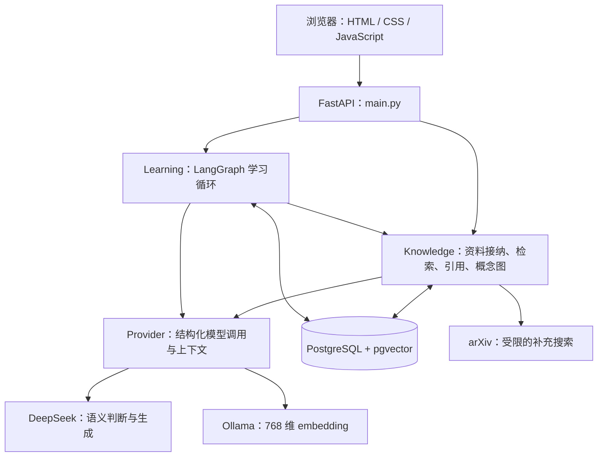

# StudyAgent Demo：模块与后续完善

本文帮助团队快速了解当前源码、数据流及下一步。当前是本机单用户 demo；DeepSeek 已接入但尚未配置密钥，真实生成、人工内容审核和完整基线对比均未运行。fake 模式验证程序流程，不用于证明语义质量或学习效果。

## 架构与主要流程

应用是单体：FastAPI 提供网页和接口，Python 执行业务规则，LangGraph 编排学习流程，PostgreSQL 保存业务状态和持久检查点。教学模式和推进条件主要由 Python 规则决定；模型协助审核、讲解、出题和自由文本评分。fake 模式下的搜索关闭或按配置决定，所有模型替身结果明确标记。

- **材料**：上传 → 格式/重复检查 → 文本解析和语义审核 → 分块 → embedding → 向量存储 → 概念图。只有接纳材料进入正式检索；审核是筛选机制，不保证事实正确。
- **自由问答**：检查空间 → 检索当前空间证据 → 检查充分性 → 必要时补充网络证据 → 生成回答 → 验证引用 ID、片段和主张支持。证据不足时说明缺口。
- **引导学习**：`prepare` 检查先修和历史、选择讲解或例子并出题 → `wait_for_student` 使用 LangGraph interrupt 暂停 → 学生提交 → `assess` 评分并更新 → 再次规划或结束。
- **恢复与范围**：session 使用稳定 thread ID；数据库约束、事务和锁保护重复/并发提交。对象读取检查空间归属，Course 与 Focus 的掌握状态独立。

## 目录与职责

| 路径 | 主要职责 | 修改时关注 |
|---|---|---|
| `studyagent/main.py` | FastAPI 应用、页面、空间、上传、聊天、会话及轨迹接口 | 保持接口校验和对外响应兼容 |
| `studyagent/schemas.py` | 请求、模型输出、题目、决策的 Pydantic 契约 | 模型输出和前端数据要同步验证 |
| `studyagent/config.py` | 从环境和 `.env` 读取配置 | `.env` 是本机文件，不进入仓库 |
| `studyagent/db.py` | SQL 边界、空间归属、锁及迁移入口 | 更新必须保留范围检查和幂等性 |
| `studyagent/knowledge.py` | 解析、接纳、分块、检索、搜索、概念图与引用 | 引用绑定实际可见证据；未接纳材料不进入检索 |
| `studyagent/learning.py` | 教学决策、LangGraph 图、测验、评分、掌握更新 | 保留暂停恢复、服务端答案和并发安全 |
| `studyagent/providers.py` | DeepSeek、Ollama、fake，模型任务、超时、结构化校验 | 真服务失败不切换 fake；不记录密钥 |
| `studyagent/context.py` | 稳定指令、动态状态、历史、证据及预算 | 压缩后保留当前空间、目标和明确纠正 |
| `studyagent/static/` | 中文页面、样式、表单与 API 调用 | 不在浏览器维护权威评分或标准答案 |
| `migrations/001_initial.sql` | 业务表、外键、唯一约束和 768 维向量字段 | schema 或向量维度变化需要新迁移 |
| `prompts/` | 稳定系统提示与开发提示记录 | 任务提示也在 `providers.py`；更改后应验证契约 |
| `data/` | 原创演示文本和 10 份公开材料获取清单 | 实验参考答案与预期动作不能进入模型可读索引 |
| `tests/`、`evaluation/` | 契约、故障和八类固定场景及实际运行记录 | fake 测试结果与真实模型评估分开记录 |
| `scripts/` | 预检、资料获取、测试和打包 | 使用 README 中的命令复现 |
| `docs/` | 材料审计、需求映射、接口、计划、演示及 AI 使用记录 | 更新实现时同步更新相应边界 |

## 当前验证与限制

2026-10-27 已运行：50 项确定性/fake/模拟 HTTP 测试通过；干净 Python 环境和新数据库通过安装、重复迁移、12 项 HTTP 流程检查及 50 项测试；源码 ZIP 解包后通过 14 项主流程检查。详情见 [进度与验证记录](progress.md) 和 `evaluation/results/`。真实 Ollama embedding 做过单次 768 维调用；这些结果不等同于真实模型的回答准确率。

当前限制：单用户本地运行；扫描 PDF 没有 OCR；网络补充限定 arXiv；掌握值是启发式；DeepSeek 认证和质量未测；完整公开语料标注、人工复核、真实 baseline 对照、时延和并发负载未完成。

## 后续完善顺序

| 优先级 | 工作 | 完成判断 |
|---|---|---|
| 1 | 配置 DeepSeek 与真实服务联调 | 本地设置 key，运行 `python scripts/preflight.py --probe-real`；记录模型名、参数、最终输入 token、失败和结果。先在新的真实模式空间验证上传、问答、引用、出题、作答和恢复。 |
| 2 | 准备并人工复核评测集 | 按 `data/sources.json` 获取总计 8–12 份公开材料，其中 2–3 份用于 Focus；固定概念、前置、问题、参考答案及动作预期。参考答案和预期动作与应用可访问的索引、提示词隔离。 |
| 3 | 运行真实场景和基础 RAG 对照 | 固定八类输入；两组保持语料、检索设置和生成模型一致，只比较共同的回答和引用能力；分别记录行动轨迹、失败案例及人工复核，不能用 fake 结果替代。 |
| 4 | 提升演示可靠性 | 用真实模型检查材料冲突、证据缺口、跨空间访问、超时/恢复、过期与重复提交；测量实际时延、输入 token 和演示并发，记录环境和结果。 |
| 5 | 补齐课程最终交付 | 补真实贡献、人工复核和组号；完成报告 PDF、源码快照、AI 使用及提示词记录；在干净环境按 README 验证。详细 rubric 和本组演示日期仍待课程通知。 |

若后续考虑多用户或公网访问，应先设计身份认证、授权和资源隔离，并重新审计数据访问；现有本机 demo 的 `USER_ID` 不能代替登录系统。OCR、额外检索来源和检索优化应由实际语料及测量结果驱动。

## 常用入口

- [README](../README.md)：安装、启动、真实/fake 模式与测试。
- [演示步骤](demo.md)：普通问题、追问、失败恢复、两分钟 pitch。
- [接口契约](api-contract.md)：每个 API 的输入和输出。
- [需求映射](requirements-map.md)：proposal 功能、实现与验证边界。
- [材料审计](material-audit.md)：proposal、指南和练习资料的实际位置与差异。
